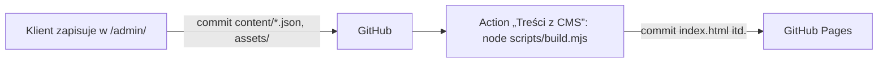

# Przebudowa strony `cwf.pl`: Centrum Wspinaczkowe Forteca

> Strona główna CWF w **oryginalnej identyfikacji** (żółty znak wspinacza, czerń, biel, zdjęcia z `cwf.pl`), przebudowana drugi raz według zasad anti-slop: układ wynika z treści, każda decyzja wizualna ma zapisany powód, bez wymyślonych danych.

| | |
|---|---|
| **Kategoria** | 01 — Strony internetowe |
| **Klient** | Centrum Wspinaczkowe Forteca (`cwf.pl`) |
| **Status** | `koncept` |
| **Data** | 2026-10-31 |

---

## Problem klienta (obserwacje z `cwf.pl`, 2026-10-31)

- **Oferta pokazana dwa razy pod rząd** (karuzela + 5 kolumn z tym samym tekstem), a telefony i e-maile recepcji powtórzone w stopce.
- **Cennik schowany na podstronie**, ceny jako puste linki `href="#"`, a cena wejścia po 21:00 różna na dwóch podstronach (25 zł / 30 zł).
- **Literówki w nagłówkach** — `Centrum WspinaczkoweForteca`, `WspinaczkoweURODZINY`, `wspianczkowe`, `Marszałkowki`, `SEKCJE WSPINCZKOWE`.
- **Brak bezpośredniego CTA do urodzin** — najbardziej dochodowej usługi.

---

## Rozwiązanie

Zostawiamy wszystko, po czym klienci rozpoznają Fortecę, a poprawiamy wykonanie:

| Zachowane z oryginału | Ulepszone |
|---|---|
| logo i żółty znak wspinacza, kolory `#ffca08` / czerń / biel | jedna, uporządkowana sekcja oferty ze zdjęciami CWF |
| hero ze zdjęciem ścianki i napisem „Centrum Wspinaczkowe **Forteca**” | pełny cennik w czytelnych tabelach ze spisem cenników obok |
| nagłówek z żółtym przyciskiem „Wybierz lokalizację” | menu mobilne i ikony SVG zamiast emoji |
| 3 lokalizacje z godzinami, telefonami i e-mailami | lokalizacje jako wiersze do porównania, kontakt bez duplikatów, linki „Jak dojechać” |
| filmy CWF z YouTube, FAQ i słowniczek | sekcja urodzin z pakietami od 600 zł i przejazdem tyrolki |
| podstrony lokalizacji (parametry ścian, udogodnienia, galerie) | parametry ścian przy lokalizacjach, galeria z dużym zdjęciem każdej hali (na telefonie karuzela) |
| podstrony oferty, formularze, regulaminy, fundacja, dane firmy | sekcja „Pierwsza wizyta” z formularzami, `regulaminy.html`, `fundacja.html`, dane rejestrowe w stopce |

---

## Kierunek wizualny (anti-slop)

Odczyt: lokalna strona trzech ścianek w Krakowie dla rodziców (urodziny) i wspinaczy (wejścia, sekcje), w identyfikacji znaku CWF. Pokrętła: **ENERGIA 2 / RYTM 3 / RUCH 2**.

| Decyzja | Powód |
|---|---|
| Czerń `#1d1d1b` + żółty `#ffca08` + biel, jasny `#f3f1ec` pod tabelami i zdjęciami | to kolory znaku CWF; więcej barw dają zdjęcia hal |
| Żółte tło tylko w sekcji urodzin | najbardziej dochodowa usługa, jedyne miejsce, gdzie kolor ma przyciągnąć wzrok |
| Romb ze znaku jako punktor, numer kroku, wskaźnik wysokościomierza i wózek tyrolki | jeden powtarzany motyw z logo zamiast ikon z biblioteki |
| Nagłówki: Saira Condensed | wąski, kanciasty krój jak napis w logo; mieści długie polskie słowa w dużym stopniu na telefonie (oryginał `cwf.pl` używa Roboto/Arial, Montserrat z poprzedniej wersji nie miał związku z marką) |
| Tekst: Inter | czytelny w 16 px, cyfry tabelaryczne w cennikach |
| Hero: tekst na czerni, zdjęcie bez przyciemnienia, skośna krawędź | zdjęcie hali widać w pełnych kolorach; skos powtarza skos skały ze znaku |
| Lokalizacje jako wiersze, nie karty | trzy hale mają te same pola, wiersze pozwalają je porównać |
| Oferta: dwie duże karty i trzy mniejsze | sekcje dla dorosłych i dzieci to stała oferta, reszta jest uzupełnieniem |
| Cennik: przyklejona kolumna ze spisem | sześć cenników jest długich; spis skraca drogę do właściwej tabeli |
| Promocje na czarnym pasie, bez kart | trzy krótkie oferty z dużą ceną czyta się w jednym rzędzie |
| Bez nadtytułów nad nagłówkami, bez tła z chwytami, bez cieni na kartach | powtarzały nagłówek albo były ozdobą bez funkcji |
| Ruch: wysokościomierz, scena tyrolki, cień nagłówka | każdy pokazuje położenie albo realną atrakcję (wieża 17 m, tyrolka 30 m); usunięte: pasek postępu (dublował wysokościomierz), wjazdy kart i nagłówków, obrót znaku |

---

## Zawartość folderu

| Plik | Opis |
|---|---|
| `index.html` | strona główna CWF (lokalizacje, oferta, urodziny, cennik, promocje, pierwsza wizyta + formularze, galeria, wideo, FAQ, kontakt) |
| `regulaminy.html` | regulaminy: Racławicka 60, wieża, Ludowa 6 i Rydlówka 32, bony upominkowe |
| `fundacja.html` | Fundacja Magnezja — cele i dane rejestrowe |
| `404.html` | strona błędu w wyglądzie serwisu (`noindex`, linki do strony głównej, cennika i kontaktu) |
| `robots.txt`, `sitemap.xml` | indeksowanie; sitemapę (z listą zdjęć) generuje `build.mjs` |
| `styles.css` | system wizualny (kolory i kroje z tabeli wyżej), czcionki z `fonts/`, efekty CSS Scroll-driven Animations |
| `script.js` | menu mobilne (Esc, „wstecz”, blokada przewijania), wyróżnienie bieżącej sekcji w menu, strzałki karuzeli urodzin, podgląd zdjęć galerii, pasek „Zadzwoń” na telefonie |
| `admin/` | panel treści dla klienta ([Sveltia CMS](https://sveltiacms.app/)): `index.html` + konfiguracja pól `config.yml` |
| `content/*.json` | treści edytowane w panelu: cennik, promocje, galeria, urodziny, oferta, lokalizacje i godziny, formularze, filmy, FAQ, telefony, tytuł i opis dla Google, zdjęcie w nagłówku |
| `scripts/build.mjs` | wstawia `content/*.json` do bloków `<!-- cms:… -->`, generuje warianty zdjęć, `og:image`, JSON-LD i `sitemap.xml` (Node 22 + `sharp`) |
| `.github/workflows/tresci.yml` | po każdym zapisie w panelu uruchamia `build.mjs` i commituje wynik |
| `img/` | **generowane** przez `build.mjs`: warianty WebP 480/960/1440 px (hero 800/1280/1920) i podgląd linku 1200×630; nieużywane pliki są usuwane |
| `fonts/` | Inter (tekst) i Saira Condensed 700/800 (nagłówki), woff2 latin + Latin Extended-A, licencja `OFL.txt` |
| `assets/logo-cwf.png`, `assets/logo-cwf.webp` | oryginalne logo z `cwf.pl` (PNG do danych strukturalnych, WebP 2× na stronie) |
| `assets/sygnet.svg`, `assets/favicon-48.png`, `assets/favicon-192.png`, `assets/apple-touch-icon.png` | znak CWF i ikony |
| `assets/*.jpg`, `assets/galeria/*.jpg` | oryginalne zdjęcia z `cwf.pl` (źródła wariantów w `img/`), nazwy opisowe: `[co-przedstawia]-[miejsce].jpg` |
| `assets/dokumenty/oswiadczenie-rodzicow.pdf` | oświadczenie rodziców z `cwf.pl` (wersja 2025) |

---

## Jak otworzyć

Dwuklik w `index.html`. Pełne animacje w Chrome / Edge 115+ i Safari 26+; w innych przeglądarkach strona działa statycznie. Menu mobilne sprawdzisz, zwężając okno poniżej 1080 px, a pasek „Zadzwoń” — poniżej 720 px.

Po zmianie treści, zdjęć, `styles.css` lub `script.js`: `npm install` (raz), potem `npm run build`. Skrypt podbija też wersje `styles.css?v=…` i `script.js?v=…` (skrót treści pliku), więc przeglądarki nie połączą nowego HTML ze starym CSS.

---

## Panel treści (CMS)

Klient zmienia ceny, zdjęcia i teksty pod adresem **`https://wiksas.github.io/cwf/admin/`** — bez dotykania kodu.

Zmiana jest widoczna na stronie po ok. 2 minutach. Strona pozostaje czystym HTML (SEO, działa bez JS, dwuklik w `index.html` nadal działa).

### Co da się edytować

| Sekcja w panelu | Gdzie trafia na stronie |
|---|---|
| Cennik | honorowane karty, spis cenników + wszystkie tabele cen (dowolna liczba cenników, tabel, kolumn i wierszy; wiersz bez cen = śródtytuł grupy) |
| Promocje | promocje na czarnym pasie; pusta lista = komunikat „Aktualnie nie mamy promocji” |
| Galeria | grupy zdjęć z opisami (alt), pierwsze zdjęcie grupy jest duże; nowe zdjęcia → `assets/galeria/` |
| Urodziny | pakiety, oświadczenie rodzica (PDF), karty atrakcji; nagłówek „N atrakcji w 2 godziny” liczy się sam |
| Oferta | karty oferty ze zdjęciami (pierwsze dwie duże) i pozycje „Także w Fortecy” |
| Lokalizacje i godziny | wiersze lokalizacji, stopka i JSON-LD dla Google z jednego źródła; w stopce sąsiednie dni o tych samych godzinach łączą się (Pt + Sb–Nd → Pt–Nd) |
| Formularze | lista dokumentów: plik (rozmiar „PDF · 49 KB” liczy się sam) albo link |
| Filmy, Pytania i słowniczek | karty YouTube, FAQ, słowniczek |
| Telefony i teksty ogólne | infolinia i telefon urodzin (wszędzie, także na podstronach), pasek górny, tekst w hero, opis dla Google |

W tekstach działa `**pogrubienie**` i `[link](adres)`. Zdjęcia są przy wgrywaniu zmniejszane do 1600 px i konwertowane do WebP; warianty do `srcset` i wymiary `width`/`height` robi `build.mjs`. Nagłówki sekcji, regulaminy i układ zostają w HTML — zmienia je programista.

> Ceny występują też w zwykłych tekstach (hero „od 35 zł”, karty oferty, urodziny, promocja po 21:00, FAQ o sprzęcie). Panel o tym przypomina przy cenniku — po zmianie cennika trzeba je poprawić ręcznie w odpowiednich sekcjach.

### Dostęp dla klienta (jednorazowo)

Najprościej (klient nie potrzebuje konta GitHub):

1. Właściciel repozytorium (`wiksas`) otwiera `/admin/` → *Sign In Using Access Token* → link w okienku prowadzi do formularza [fine-grained token](https://github.com/settings/personal-access-tokens/new) z zaznaczonym *Contents: Read and write*.
2. W formularzu: *Repository access → Only select repositories → `wiksas/cwf`*, ważność np. 1 rok → *Generate token*.
3. Token przekazać klientowi; klient wkleja go w to samo okienko na `/admin/`. Token zostaje w przeglądarce, przy kolejnych wizytach logowanie nie jest potrzebne. Odebranie dostępu = usunięcie tokenu w GitHubie. Commity z panelu są podpisane kontem właściciela.

Z własnym kontem klienta (commity podpisane jego nazwą): właściciel dodaje konto w **Settings → Collaborators** (rola *Write*). Fine-grained token współpracownika nie obejmuje repozytoriów należących do innego konta osobistego, więc klient tworzy [token classic z zakresem `repo`](https://github.com/settings/tokens/new?scopes=repo&description=Panel%20CWF) i wkleja go w okienku logowania.

Logowanie przyciskiem *Sign In with GitHub* jest wyłączone (`auth_methods: [token]` w `admin/config.yml`), bo wymaga serwera OAuth. Żeby je włączyć: wdrożyć [Sveltia CMS Authenticator](https://github.com/sveltia/sveltia-cms-auth) na Cloudflare Workers (darmowy plan), dopisać `base_url: <adres workera>` i `auth_methods: [oauth, token]`.

### Praca programisty

- Treści zmieniaj w `content/*.json` (albo w panelu), potem `npm run build` — skrypt podmienia tylko bloki `<!-- cms:nazwa --> … <!-- /cms:nazwa -->`, reszta HTML jest ręczna. Nie edytuj HTML wewnątrz tych bloków — zostanie nadpisany.
- Nowy blok: dodaj znaczniki w HTML, funkcję w `BLOCKS` w `scripts/build.mjs` i pola w `admin/config.yml`.
- Błąd w treści (brak pliku zdjęcia, więcej cen niż kolumn, zły zakres dni) zatrzymuje Action z opisem w logu — strona zostaje w poprzedniej wersji.
- Panel lokalnie: `python -m http.server` w katalogu repo → `http://localhost:8000/admin/` → *Work with Local Repository* (Chrome/Edge) → wskaż katalog repozytorium; zapis trafia prosto do plików, potem `npm run build`.

---

## Efekty scroll-driven

| Element | Efekt | Oś czasu |
|---|---|---|
| `.site-header::after` | cień nagłówka pojawia się po zjechaniu z góry | `scroll(root)`, `0 150px` |
| `.altimeter__climber` | wysokościomierz 0–17 m (wysokość wieży CWF): od 1500 px z podziałką na marginesie, na węższych ekranach wąska lina z rombem przy samej krawędzi okna (nie zasłania tekstu). Romb można przeciągnąć (albo kliknąć w linę), żeby przewinąć stronę (`script.js`); bez animacji CSS pozycję rombu ustawia skrypt | `scroll(root)` |
| `.sd-hscroll` | atrakcje urodzinowe na komputerze (od 920 × 660 px): przyklejona scena, pionowe przewijanie strony przesuwa karty w bok | `--bday-scroll` (`view-timeline-name`), `contain 8% … 92%` |
| `.zipline__rider` | romb tyrolki jedzie po 30-metrowej linie razem z kartami w scenie; długość przejazdu (`--zip-x1`) i pochylenie liny liczy `script.js` | `--bday-scroll` |

Romb tyrolki jest też suwakiem galerii (`script.js`, `role="slider"`): można go przeciągnąć myszą lub palcem, kliknąć w dowolne miejsce liny albo sterować strzałkami, Home/End i PageUp/PageDown; obok są strzałki ‹ › z licznikiem. W scenie suwak i strzałki przewijają **stronę** do odpowiedniego miejsca sceny (karty dalej prowadzi animacja CSS). Na telefonie, przy ograniczonym ruchu i w przeglądarkach bez `animation-timeline` galeria jest zwykłą karuzelą z `scroll-snap`, a suwak przewija same karty. Bez JS romb jest tylko ozdobą.

> Scena to świadome odstępstwo od `jakosc-strony.md` §7 („bez przejmowania przewijania”) na życzenie: strona przewija się normalnie (nic nie blokuje ani nie przyspiesza przewijania), ale przez ok. 1,6 ekranu pionowy ruch zamienia się w poziomy przesuw kart.

Wszystkie animacje działają tylko pod `prefers-reduced-motion: no-preference` i `@supports (animation-timeline: view())`, wyłącznie na `transform` / `opacity`.

---

## Przed wdrożeniem

- [ ] Potwierdzić z klientem cenę wejścia po 21:00 — przyjęto **30 zł** z zakładki „Cennik” (edytowanej 27.02.2026); strona główna `cwf.pl` podawała 25 zł.
- [ ] Szczegóły promocji „Przyprowadź znajomego” (na `cwf.pl` brak konkretów).
- [ ] Formularz osobowy nadal leży na Google Drive klienta — warto przenieść do `assets/dokumenty/`.
- [ ] Zdjęcia w wyższej rozdzielczości z archiwum klienta — galerie mają źródła 768 px, więc podgląd pełnoekranowy pokazuje najwyżej 768 px.
- [ ] Canonical, `og:*`, JSON-LD, `robots.txt` i `sitemap.xml` zakładają domenę `https://cwf.pl/` — podgląd na GitHub Pages jest kopią wskazującą na nią.
- [ ] Po przeniesieniu na `cwf.pl`: zmienić `site_url` w `admin/config.yml` (oraz `repo`, jeśli zmieni się repozytorium).
- [ ] Na hostingu docelowym: `https` + 301 z `www.cwf.pl` na `cwf.pl`, długie cache dla `img/`, `fonts/`, `styles.css`, `script.js` (adresy mają wersję), kod 404 dla `404.html`.
- [ ] Przekierowania 301 ze starych adresów WordPressa:

| Stary adres | Nowy adres |
|---|---|
| `/ludowa-6/`, `/raclawicka-60/`, `/rydlowka-32/` | `/#ludowa-6`, `/#raclawicka-60`, `/#rydlowka-32` |
| `/sekcje-wspinaczkowe-dorosli/`, `/sekcje-wspinaczkowe-dzieci/` | `/#sekcje-dorosli`, `/#sekcje-dzieci` |
| `/urodziny-dla-dzieci/` | `/#urodziny` |
| `/zajecia-wspinaczkowe-dla-szkol/`, `/zajecia-dla-osob-z-niepelnosprawnoscia/` | `/#szkoly`, `/#niepelnosprawnosc` |
| `/cennik/`, `/pytania-i-odpowiedzi/`, `/kontakt/`, `/formularze/` | `/#cennik`, `/#pytania`, `/#kontakt`, `/#formularze` |
| `/regulaminy/`, `/fundacja/` | `/regulaminy.html`, `/fundacja.html` |
| `/wp-content/uploads/2026/01/oswiadczenie-rodzicow-nowe-2025.pdf` | `/assets/dokumenty/oswiadczenie-rodzicow.pdf` |

---

## SEO i jakość (`pozycjonowanie.md`, `jakosc-strony.md`)

Zrobione na stronie:

| Obszar | Co |
|---|---|
| `<head>` | unikalne `title` (≤ 60 zn.) i `description` (≤ 160 zn.) z frazą i miastem na każdej podstronie, `canonical`, `robots`, `og:*` z obrazem 1200×630, `twitter:card`, favicony 48/192 + `apple-touch-icon` 180 |
| Teksty | jeden `h1` z frazą („Ścianka wspinaczkowa w Krakowie” jako etykieta nad nazwą), frazy w części `h2` (lokalizacje, oferta, urodziny, cennik, FAQ), adresy z „Kraków” na kartach i w stopce |
| Dane strukturalne | jeden `@graph`: `WebSite`, `SportsOrganization` (z usługami w `makesOffer`), 3 × `SportsActivityLocation` (adres, `openingHoursSpecification`, `hasMap`, zdjęcia), `WebPage`, `FAQPage` z widocznych pytań; podstrony: `WebPage`, fundacja dodatkowo `NGO`. validator.schema.org: 0 błędów, 0 ostrzeżeń |
| Obrazy | opisowe nazwy plików, prawdziwe `alt` (poprawione: zdjęcie „z lotu drona” nim nie było), WebP w 3 rozmiarach z `srcset`/`sizes`, `width`/`height`, `lazy` poniżej pierwszego ekranu; zdjęcie hero jako `` z `fetchpriority="high"` i `preload` |
| Szybkość | czcionki lokalnie (woff2, `font-display: swap`, `preload`), brak zasobów z zewnętrznych domen, skrypt z `defer`, wersje plików w adresach |
| Indeksowanie | `robots.txt` z sitemapą, `sitemap.xml` z `lastmod` i zdjęciami (`image:`), `404.html` z `noindex`, panel `/admin/` z `noindex` i poza sitemapą |
| Wygoda | galeria: przesuwanie palcem na telefonie, podgląd pełnoekranowy (×, Esc, tło, „wstecz”, ← →, przesunięcie palcem, licznik, powrót zaznaczenia); karuzela urodzin ze strzałkami i licznikiem; menu mobilne zamyka się też „wstecz” i blokuje przewijanie; bieżąca sekcja wyróżniona w menu; pasek „Zadzwoń / Urodziny” na telefonie, chowa się przy stopce |
| Dostępność | tekst do czytania ≥ 16 px na telefonie, pola dotyku ≥ 44 px, niższy nagłówek na telefonie (ok. 8% ekranu), `prefers-reduced-motion` wyłącza też przesunięcia przy najechaniu i płynne przewijanie, ukryte dopiski dla czytników przy linkach „Jak dojechać” i filmach |

Rekomendacje (wymagają danych od klienta, decyzji albo zmian poza stroną):

- **Podstrony usług** (`jakosc-strony.md` §1): sekcje dla dorosłych, sekcje dla dzieci, urodziny, szkoły, zajęcia dla osób z niepełnosprawnością (+ ewentualnie 3 lokalizacje) z unikalną treścią — zakres pakietu „Standard”. Frazy do przypisania: „sekcja wspinaczkowa dla dzieci Kraków”, „urodziny na ściance Kraków”, „wspinaczka dla szkół Kraków”.
- **Opinie klientów** jako tekst z podpisem + link do opinii Google — potrzebne prawdziwe opinie i zgody autorów; bez nich sekcji nie dodajemy.
- **Link do wizytówek Google** (Profil Firmy) dla 3 lokalizacji — do stopki i do `hasMap` zamiast wyszukiwania w Mapach.
- **Wizytówka Google, Bing Places, katalogi** (np. lokalne serwisy sportowe i rodzinne) z identycznymi danymi: nazwa, adresy, telefony jak w panelu.
- **Google Search Console + Bing Webmaster Tools** po starcie domeny: weryfikacja DNS, wysłanie `sitemap.xml`.
- **Pomiar konwersji** (kliknięcia `tel:`) — narzędzie bez ciasteczek (np. Plausible) albo z banerem zgody; decyzja klienta. Strona nie ma formularza ani ciasteczek, więc dziś nie potrzebuje banera; polityka prywatności będzie potrzebna razem ze statystykami.
- **Filmy**: na stronie są tylko linki do YouTube, więc bez `VideoObject` (dane strukturalne nie mogą opisywać treści, której nie ma na stronie). Tytuły filmów na YouTube warto uzupełnić o „Kraków” i link do strony w opisie.
- **PageSpeed Insights** (mobile) i **Rich Results Test** — uruchomić po wdrożeniu na `cwf.pl`.

---

## Oferta dla klienta

| Pakiet | Zakres dla CWF | Cena orientacyjna (netto) |
|---|---|---|
| **Start — nowa strona główna** | wdrożenie tej strony głównej w WordPressie, poprawki treści i cennika | **2 900 zł** |
| **Standard — cały serwis** | strona główna + 3 podstrony lokalizacji + 5 podstron oferty + cennik + FAQ, SEO lokalne | **5 400 zł** |
| **Premium — serwis + rezerwacje** | Standard + kalkulator urodzin i czat FAQ | **7 800 zł** |

---

## Argumenty sprzedażowe

1. **Klient od razu rozpozna swoją firmę** — to wciąż Forteca: to samo logo, kolory i zdjęcia.
2. **Rodzic znajdzie cenę urodzin w 5 sekund** — pakiety od 600 zł i numer `509 838 500` są na stronie głównej, bez przechodzenia do cennika.
3. **Wygodnie na telefonie** — menu mobilne, duże przyciski `tel:` i tabela cennika, która się nie rozjeżdża.
